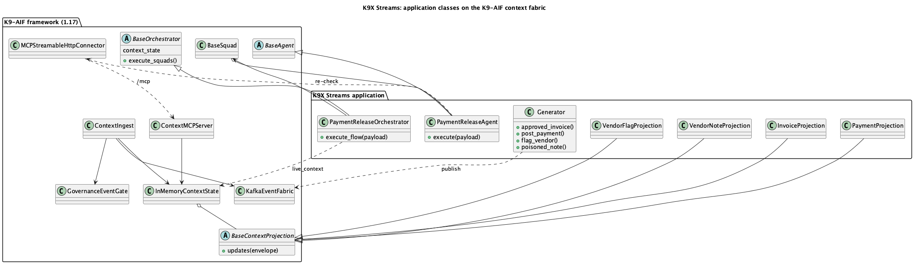
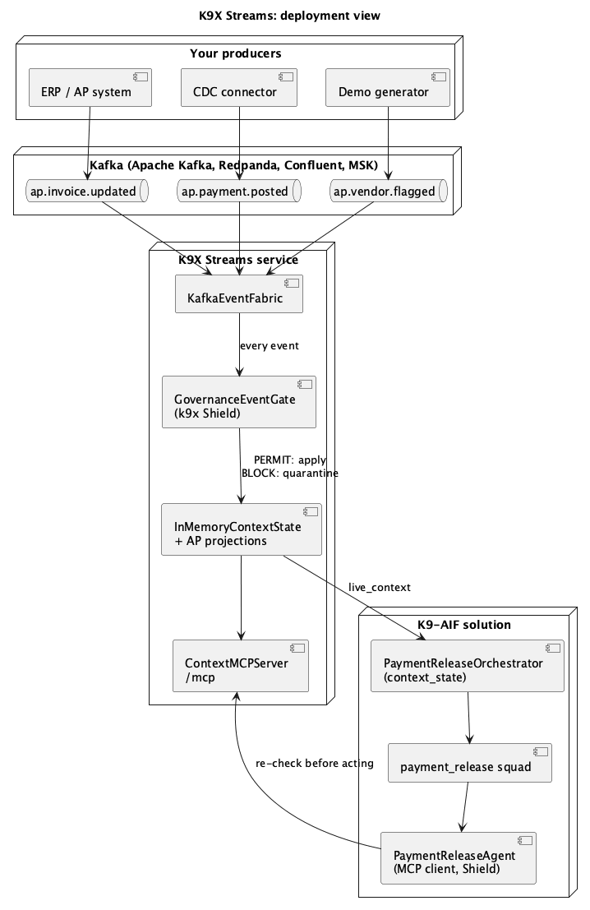

# K9X Streams

Real-time, governed context for agents built on [K9-AIF](https://github.com/k9aif/k9-aif-framework).

Agents need the current state of what they reason about, not yesterday's snapshot.
K9X Streams turns event streams (Kafka / Redpanda, Confluent, change data capture) into a
live state store and serves it over MCP: the latest value per entity and what just changed,
each with an `as_of` timestamp, under the framework's governance (Shield screening of tool
results, Zero Trust scope, PII masking). Rules on a stream can also start agents through the
K9-AIF Router.

Status: Phase 1 running, built on the K9-AIF **context fabric** (framework 1.17). Design notes: [DESIGN.md](DESIGN.md).

## How it is built

K9X Streams is an application built on K9-AIF. The streaming machinery is the framework's;
this repository adds only the Accounts Payable parts.

| From the K9-AIF framework (1.17) | In this repository |
|---|---|
| `KafkaEventFabric`, `EventEnvelope` | `streams/generator.py`: simulated AP events |
| `GovernanceEventGate` with `ShieldGovernance` (`PromptInjectionCheck`, `PaymentDiversionCheck`) | `streams/fabric.py`: wiring through `StreamsFactory` |
| `BaseContextProjection`, `InMemoryContextState` | `streams/projections.py`: invoice, payment, vendor flag, vendor note |
| `ContextIngest` | |
| `ContextMCPServer` (`/mcp`) | |
| `BaseOrchestrator(context_state=...)`, `BaseSquad` | `streams/orchestrator.py`: `PaymentReleaseOrchestrator` |
| `BaseAgent`, `MCPStreamableHttpConnector`, `screen_tool_result` | `streams/agent.py`: `PaymentReleaseAgent` |





To use the same fabric in your own solution, follow the framework's
[Developer Guide 15.7](https://github.com/k9aif/k9-aif-framework/blob/main/docs/developers/Developer-guide.md#157-live-context-from-event-streams-context-fabric-117):
turn on `streams:` in config, write one projection per business event, wire it at the entry
point, hand your orchestrator the state, and re-check over MCP before acting.

## Run it locally

```bash
cp .env.sample .env      # optional; leave KAFKA_BROKER unset for a local Redpanda
./run.sh                 # http://localhost:8780
./run.sh stop-kafka      # stop the local Redpanda run.sh started
```

`run.sh` uses the sibling `k9-aif-framework` venv when present, otherwise a local `.venv`
with `requirements.txt`. With no `KAFKA_BROKER` it starts Redpanda in podman or docker on
`localhost:19092`. Use another settings file with `STREAMS_ENV_FILE=.env.confluent ./run.sh`.

| URL | What |
|---|---|
| `/` | Landing page: what K9X Streams is and what it gives a K9-AIF solution |
| `/demo` | Live demo: generator → Kafka → consumer → live state → MCP → agent |
| `/mcp` | MCP endpoint (streamable HTTP): `get_current`, `recent_changes`, `query`, resource `streams://{entity}/{id}` |

## The demo

A generator publishes accounts-payable events to `ap.invoice.updated`, `ap.payment.posted`
and `ap.vendor.flagged`. The consumer folds them into the live state store. A
`PaymentReleaseOrchestrator` names the invoice (`live_context_refs`), so its squad receives the
invoice's current state as `live_context`. The `PaymentReleaseAgent` (a `BaseAgent` under
`ShieldGovernance`) reviews it, then re-checks over MCP just before release, screening every
answer with the framework's tool-result guard. Every event has already passed the Shield gate.
Four scenarios:

| Scenario | What happens on the stream | Agent decision |
|---|---|---|
| Release | nothing changes | RELEASE |
| Duplicate payment | a payment for the invoice posts during review | HOLD, duplicate prevented |
| Vendor flagged | the vendor is flagged during review | HOLD |
| Poisoned note | a vendor note carries injected instructions | refused at the gate, vendor quarantined, HOLD for human review |

## Your Kafka or Confluent

Set `KAFKA_BROKER` and, for brokers that need sign-in, `KAFKA_SECURITY_PROTOCOL`
(`SSL`, `SASL_PLAINTEXT`, `SASL_SSL`) with `KAFKA_SASL_MECHANISM`, `KAFKA_SASL_USERNAME`,
`KAFKA_SASL_PASSWORD`. Confluent Cloud uses `SASL_SSL` + `PLAIN` with an API key and secret.
Topic names are set with `STREAMS_TOPIC_*`. See [.env.sample](.env.sample).

Part of the K9X ecosystem · Apache-2.0
